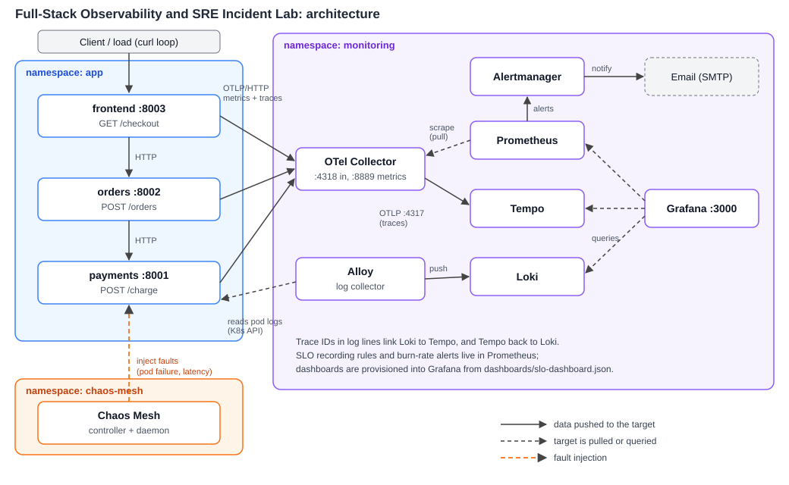

# Full-Stack Observability and SRE Incident Lab

A three-service Python app running on Kubernetes, fully instrumented with OpenTelemetry (metrics, logs, traces), with SLOs and error-budget dashboards, email alerting, and Chaos Mesh fault injection. Two real incidents were injected, investigated using only the dashboards, and written up as a blameless postmortem.

Built solo as an internship project (DevOps track).



## What is in this repo

| Area | What it does |
|---|---|
| **App** | `frontend`, `orders`, `payments` (FastAPI). One checkout request crosses all three |
| **Instrumentation** | OpenTelemetry SDK in every service. Logs carry `trace_id` and `span_id` |
| **Pipeline** | OpenTelemetry Collector, Prometheus (metrics), Tempo (traces), Loki + Alloy (logs), Grafana |
| **SLOs** | Availability 99.9% and latency 95% under 500 ms, with recording rules and an error-budget dashboard |
| **Alerting** | Multi-window burn-rate alerts, Alertmanager routing by severity, email notifications |
| **Chaos** | Chaos Mesh experiments: pod failure and network latency on `payments` |
| **Write-up** | [Postmortem](docs/postmortem.md), [architecture and API docs](docs/architecture.md), [test results](docs/test-results.md) |

## Repository layout

```
services/{frontend,orders,payments}/   main.py, requirements.txt, Dockerfile
k8s/                                   Kubernetes manifests and Helm values
  app.yaml                             the three services (namespace: app)
  otel-collector.yaml  tempo.yaml  loki.yaml  alloy.yaml  grafana.yaml
  prom-values.yaml                     scrape config, SLO recording rules, alert rules
  alertmanager-values.yaml             email routing (set your address, see below)
  chaos-mesh-values.yaml               Chaos Mesh settings for kind (containerd)
chaos/                                 Chaos Mesh experiment definitions
dashboards/slo-dashboard.json          Grafana SLO and error-budget dashboard
docs/                                  architecture, test results, postmortem, evidence
```

## Prerequisites

Developed on a single-node `kind` cluster on a Windows laptop with 8 GB RAM.

- Docker Desktop (on Windows, with WSL2). **Cap its memory** by creating `%UserProfile%\.wslconfig`:
  ```
  [wsl2]
  memory=6GB
  processors=4
  ```
  then run `wsl --shutdown` and restart Docker Desktop.
- `kubectl`, `kind`, `helm`
- An email account that can send SMTP. The config assumes Gmail with an **app password** (needs 2-Step Verification)

The commands below are PowerShell. On Linux or macOS, replace the backtick line continuations with `\`.

## Setup

### 1. Create the cluster

```powershell
kind create cluster --name lab
```

### 2. Build the images and load them into the cluster

`kind` has its own image store, so images must be loaded after building.

```powershell
foreach ($s in "payments","orders","frontend") {
  docker build -t "${s}:0.3" "services/$s"
  kind load docker-image "${s}:0.3" --name lab
}
```

### 3. Install Prometheus

Alertmanager is enabled in step 5, once your email is set.

```powershell
helm repo add prometheus-community https://prometheus-community.github.io/helm-charts
helm repo update
helm install prometheus prometheus-community/prometheus `
  --namespace monitoring --create-namespace `
  --set alertmanager.enabled=false `
  --set prometheus-pushgateway.enabled=false `
  --set prometheus-node-exporter.enabled=false `
  --set kube-state-metrics.enabled=false `
  --set server.persistentVolume.enabled=false
```

### 4. Install the rest of the monitoring stack

```powershell
kubectl apply -f k8s/tempo.yaml
kubectl apply -f k8s/loki.yaml
kubectl apply -f k8s/otel-collector.yaml
kubectl apply -f k8s/alloy.yaml
kubectl create configmap grafana-dashboards --from-file=slo.json=dashboards/slo-dashboard.json -n monitoring
kubectl apply -f k8s/grafana.yaml
kubectl get pods -n monitoring
```

Wait until every pod is `Running`. The dashboard ConfigMap must exist before Grafana starts.

### 5. Turn on SLO rules and email alerting

1. Open `k8s/alertmanager-values.yaml` and replace `YOUR_EMAIL@gmail.com` in all three places.
2. Create a Gmail app password (Google Account, App passwords) and remove any spaces.
3. Apply, passing the password on the command line so it is never stored in a file:

```powershell
helm upgrade prometheus prometheus-community/prometheus -n monitoring --reuse-values `
  -f k8s/prom-values.yaml -f k8s/alertmanager-values.yaml `
  --set-string alertmanager.config.global.smtp_auth_password=YOUR_APP_PASSWORD
```

To test the email path, temporarily add an always-firing rule (`expr: vector(1)`, `for: 0m`) to `prom-values.yaml`, apply, confirm the email arrives, then remove it and apply again.

### 6. Deploy the app

```powershell
kubectl apply -f k8s/app.yaml
kubectl get pods -n app
```

All three pods should show `1/1 Running`.

### 7. Install Chaos Mesh

```powershell
helm repo add chaos-mesh https://charts.chaos-mesh.org
helm repo update
helm install chaos-mesh chaos-mesh/chaos-mesh -n chaos-mesh --create-namespace -f k8s/chaos-mesh-values.yaml
```

`kind` uses containerd, which is why the values file sets the runtime and socket path.

## Using it

Each port-forward needs its own terminal.

| UI | Command | URL |
|---|---|---|
| App (frontend) | `kubectl port-forward svc/frontend 8003:8003 -n app` | http://127.0.0.1:8003/checkout |
| Grafana | `kubectl port-forward svc/grafana 3000:3000 -n monitoring` | http://localhost:3000 (admin / admin, lab only) |
| Prometheus | `kubectl port-forward svc/prometheus-server 9090:80 -n monitoring` | http://localhost:9090 |
| Alertmanager | `kubectl port-forward svc/prometheus-alertmanager 9093:9093 -n monitoring` | http://localhost:9093 |

Generate steady traffic (about 15 minutes):

```powershell
1..900 | ForEach-Object { curl.exe -s -o NUL -w "%{http_code} " "http://127.0.0.1:8003/checkout"; Start-Sleep 1 }
```

In Grafana, open **Dashboards, Checkout SLO and Error Budget**. In **Explore**, switch between Prometheus, Loki, and Tempo. Log lines containing `trace_id` have an **Open trace in Tempo** button, and each span has a **LOG** button back to Loki.

## SLOs and alerts

| SLO | SLI | Target | Window | Budget |
|---|---|---|---|---|
| Availability | successful checkouts / all checkouts | 99.9% | 30 days | 0.1% |
| Latency | checkouts under 500 ms / all checkouts | 95% | 30 days | 5% |

The latency target was chosen from measurement. The brief's example (99.9% under 300 ms) was measured at about 87% on a healthy system, so it was not realistic.

| Alert | Condition | Severity |
|---|---|---|
| `CheckoutAvailabilityFastBurn` | burn rate above 14.4 on 1 h and 5 m | critical |
| `CheckoutAvailabilitySlowBurn` | above 6 on 1 h and 30 m | warning |
| `CheckoutLatencyFastBurn` | above 14.4 on 1 h and 5 m | critical |
| `CheckoutLatencySlowBurn` | above 6 on 1 h and 30 m | warning |

A critical alert inhibits the warning for the same SLO. Burn rate is the error ratio divided by the error budget, so a burn rate of 1 spends the budget exactly over 30 days.

## Chaos experiments

Run with traffic flowing and the dashboard open. Note the start time, then investigate using metric, then trace, then log.

```powershell
Get-Date; kubectl apply -f chaos/01-payments-pod-failure.yaml     # 5 minutes
kubectl delete podchaos payments-pod-failure -n app               # clean up afterwards

Get-Date; kubectl apply -f chaos/02-payments-latency.yaml         # 6 minutes
kubectl delete networkchaos payments-latency -n app
```

| Experiment | Expected | What actually happened |
|---|---|---|
| Pod failure | Failed checkouts | As expected. Alert fired in about 2 minutes. Root cause: connection refused to `payments` |
| 600 ms latency | Slow but successful checkouts | Slow **and** failing. The delay also slowed health-check replies past the 1 s probe timeout, so Kubernetes removed and restarted the only `payments` pod |

Full detail, timelines, and action items are in [docs/postmortem.md](docs/postmortem.md).

## Results

| Measure | Value |
|---|---|
| Healthy availability | 100% |
| Healthy latency, under 300 ms | about 86 to 89% |
| Healthy latency, under 500 ms | about 97 to 98% |
| Typical healthy checkout | about 0.1 to 0.3 s (one traced request: 178 ms) |
| Incident 1 peak burn rate | 631 (5 m), 483 (1 h) against a 14.4 threshold |
| Incident 1 time to detect | about 2 minutes |
| Incident 2 time to detect | about 2 minutes |
| Alert delivery | verified end to end by email |

More in [docs/test-results.md](docs/test-results.md).

## Troubleshooting (problems hit while building this)

- **`uvicorn` or `pip` installs into the wrong Python on Windows.** Use `python -m pip` and `python -m uvicorn` so the active environment is always used.
- **Slow requests on Windows locally.** `localhost` can try IPv6 first and wait about 2 s before falling back. Use `127.0.0.1`. Inside Kubernetes the services use Service names, so this does not apply.
- **`CrashLoopBackOff` with a clean shutdown in the logs.** The container port did not match the probe port. Check the Dockerfile `CMD` against the manifest.
- **`ImagePullBackOff` on an app pod.** The image was not loaded with `kind load docker-image`.
- **Prometheus rate shows 0 after a burst.** `rate()` only sees change inside its window. Query the raw counter or use `increase(...)` over a longer window.
- **Email not sent.** Check `kubectl logs prometheus-alertmanager-0 -n monitoring`. `missing '@'` means a bad From address, and `535 BadCredentials` means the app password was rejected.
- **A `helm upgrade` changes email settings back.** Always pass both values files and the password, since `--reuse-values` keeps whatever the previous upgrade used.
- **Files saved by Notepad get a `.txt` extension.** Check with `dir`.

## Known limitations and next steps

- Orders are kept in memory. There is no database.
- One replica per service, so one pod failing is a full outage. Running two replicas is the first fix.
- Probe timeouts are 1 s, which is too tight. Raise them and separate liveness from readiness.
- Pods showed frequent background restarts, which made the baseline noisy. See the postmortem.
- Prometheus, Loki, Tempo, and Grafana have no persistent storage, so data is lost if their pods restart. Dashboards are saved as files for this reason.
- SLO panels calculate over the selected dashboard range, not a true 30-day window.
- Burn-rate alerts need a minimum-traffic condition to avoid firing on small samples.
- Credentials: Grafana uses `admin` / `admin` for a local lab only. Never commit the SMTP password.

## Documentation

- [Architecture and API reference](docs/architecture.md)
- [Test results](docs/test-results.md)
- [Postmortem](docs/postmortem.md)
