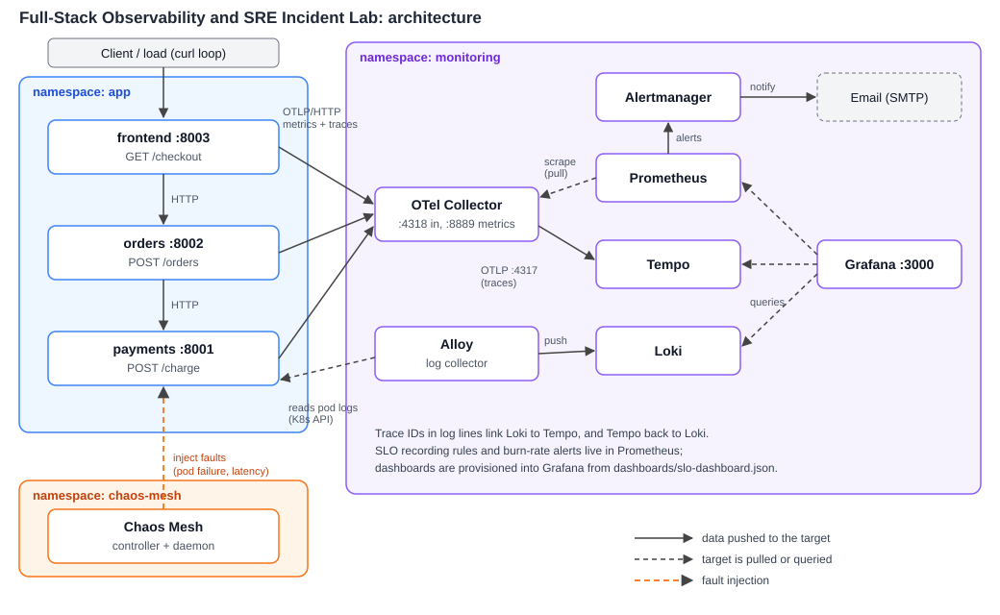
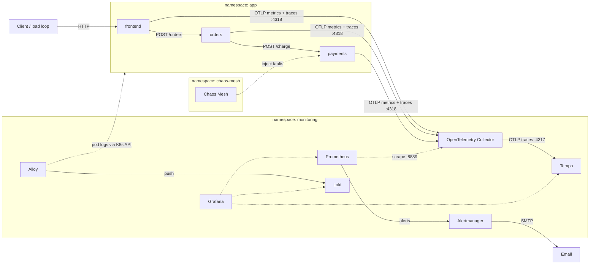

# Architecture and API reference

## Diagram



The same architecture as text (renders on GitHub):



Solid arrows are data pushed to the target. Dashed arrows are pulled or queried.

## Components

| Component | Role | Port | Config |
|---|---|---|---|
| frontend, orders, payments | The application | 8003, 8002, 8001 | `k8s/app.yaml`, `services/*` |
| OpenTelemetry Collector | Receives OTLP, exposes metrics for Prometheus, forwards traces to Tempo | 4317, 4318, 8889 | `k8s/otel-collector.yaml` |
| Prometheus | Stores metrics, evaluates SLO recording and alert rules | 9090 (service port 80) | `k8s/prom-values.yaml` |
| Alertmanager | Routes, groups, and inhibits alerts, then sends email | 9093 | `k8s/alertmanager-values.yaml` |
| Tempo | Stores traces | 3200 (query), 4317 and 4318 (OTLP) | `k8s/tempo.yaml` |
| Loki | Stores logs, indexed by labels only | 3100 | `k8s/loki.yaml` |
| Alloy | Reads pod logs through the Kubernetes API and pushes them to Loki | 12345 | `k8s/alloy.yaml` |
| Grafana | Dashboards and Explore, data sources and links provisioned | 3000 | `k8s/grafana.yaml`, `dashboards/` |
| Chaos Mesh | Injects pod and network faults | none used | `k8s/chaos-mesh-values.yaml`, `chaos/` |

## Signal flows

- **Metrics:** SDK in each service, OTLP/HTTP to the Collector, Collector's Prometheus exporter on `:8889`, scraped by Prometheus every 15 s. Services export every 10 s.
- **Traces:** SDK, OTLP/HTTP to the Collector, OTLP/gRPC to Tempo. The `traceparent` header carries the trace across services (context propagation).
- **Logs:** services write to stdout. Alloy tails each pod in the `app` namespace and pushes to Loki with the labels `namespace`, `pod`, `container`, `service`. `trace_id` stays in the log text, not a label, to keep cardinality low.
- **Alerts:** Prometheus evaluates rules and sends to Alertmanager, which emails by severity.
- **Cross-links:** Loki derives a link from `trace_id=...` to Tempo. Tempo links a span to the matching Loki logs by service and trace ID.

## Service API

All services also expose `GET /health` returning `{"status": "ok"}`. It is used by the Kubernetes liveness and readiness probes (timeout 1 s).

### frontend (port 8003)

| Endpoint | Description |
|---|---|
| `GET /checkout?amount=<int>` | Optional `amount`, default 2500. Calls `orders` (3 s timeout) |

- `200`: `{"message": "Thank you for your order", "order": {...}}`
- `502`: `{"detail": "checkout failed"}` if `orders` fails or times out

### orders (port 8002)

| Endpoint | Description |
|---|---|
| `POST /orders?amount=<int>` | Required `amount`. Calls `payments` (2 s timeout), then stores the order in memory |

- `200`: `{"id": <int>, "amount": <int>, "status": "paid"}`
- `502`: `{"detail": "payment failed"}` if `payments` fails or times out
- `422`: invalid `amount` (rejected by FastAPI before the handler runs)

### payments (port 8001)

| Endpoint | Description |
|---|---|
| `POST /charge?amount=<int>` | Simulates a card charge with a random delay of 50 to 200 ms |

- `200`: `{"status": "charged", "amount": <int>}`
- `422`: invalid `amount`

Interactive docs are available at `/docs` on each service when run locally.

## Telemetry reference

### Custom metrics

OpenTelemetry names are converted by the Prometheus exporter (dots become underscores, units and `_total` suffixes are added).

| OTel instrument | Prometheus series | Type | Labels |
|---|---|---|---|
| `checkouts` (frontend) | `checkouts_total` | counter | `outcome` = `success` or `error` |
| `checkout.duration` (frontend, seconds) | `checkout_duration_seconds_bucket`, `_count`, `_sum` | histogram | `le` |
| `orders.created` (orders) | `orders_created_total` (expected name) | counter | none |
| `orders.payment_failures` (orders) | `orders_payment_failures_total` (expected name) | counter | none |

The histogram bucket edges are `0.05, 0.1, 0.2, 0.3, 0.5, 1, 2, 5` seconds. The 0.3 and 0.5 edges are deliberate, so the latency SLI can be measured exactly. Every series also carries `service_name` (from the OTel resource). `job` is always `otel-collector`, because Prometheus scrapes the Collector, not the services. The FastAPI and httpx instrumentation also produce standard HTTP server and client metrics.

Label rule: labels must have a small, bounded set of values. Unbounded values such as `order_id` or `trace_id` belong in logs and traces, never in metric labels.

### Recording rules (`k8s/prom-values.yaml`)

| Rule | Meaning |
|---|---|
| `slo:checkout_error_ratio:rate{5m,30m,1h}` | failed checkouts / all checkouts |
| `slo:checkout_slow_ratio:rate{5m,30m,1h}` | checkouts over 500 ms / all checkouts |
| `slo:checkout_availability_burn:rate{5m,30m,1h}` | error ratio / 0.001 |
| `slo:checkout_latency_burn:rate{5m,30m,1h}` | slow ratio / 0.05 |

### Log format

```
2026-11-13 19:42:46,891 ERROR service=orders trace_id=<32 hex> span_id=<16 hex> payment call failed: ConnectError(...)
```

Timestamps in the application log are UTC. Grafana shows browser time.

### Traces

Spans come from auto-instrumentation: a `SERVER` span per incoming request (FastAPI), a `CLIENT` span per outgoing call (httpx), and small `INTERNAL` `http send` spans. A failed request marks its span `ERROR`, and the error status propagates up to the root.

## Design decisions

- **One Collector in the middle.** Services only know one address. Changing a backend means editing the Collector config, not redeploying the apps.
- **Plain manifests for Loki, Tempo, Alloy, Grafana, and the Collector.** Their Helm charts have changed repositories and options recently, and the manifests are short and readable. Prometheus and Chaos Mesh use Helm.
- **No persistence for the monitoring stack.** Saves memory on an 8 GB machine. Dashboards and rules are kept as files in the repo.
- **Credentials.** The SMTP password is passed at deploy time and never stored in the repo.
